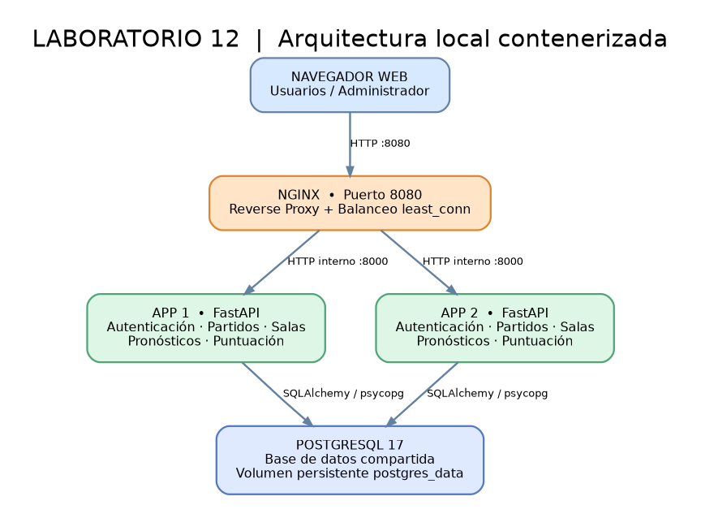

# MundialLab12 — Laboratorio 12: Despliegue de instancias virtualizadas

Aplicación educativa de pronósticos de fútbol, **sin apuestas ni dinero real**, lista para ejecutarse **localmente con Docker Desktop (Windows 11, WSL 2)**.

Contiene **FastAPI + HTML/Jinja + CSS + PostgreSQL + Nginx**. Docker Compose levanta **dos instancias equivalentes (`app1`, `app2`)** de la aplicación detrás de un **balanceador Nginx** y utiliza **una base de datos compartida**.

> Importante: esta app es un simulador educativo. No descarga partidos reales ni verifica automáticamente los resultados de un Mundial: el administrador crea los encuentros y registra marcadores de demostración.



## 1. Requisitos

- Windows 10/11 compatible con Docker Desktop, virtualización activada y WSL 2.
- Docker Desktop configurado en modo **Linux containers**.
- Conexión a Internet **solo para descargar Docker y las imágenes en el primer arranque**.
- Editor de archivos, por ejemplo Visual Studio Code, o Bloc de notas.
- Puerto `8080` libre.
- **No necesitas instalar PostgreSQL, Nginx, Python ni Node.js en Windows** para arrancar la aplicación.

Manual oficial: https://docs.docker.com/desktop/setup/install/windows-install/

## 2. Ejecución desde cero — PowerShell en Windows

1. Instalar WSL 2 (PowerShell **Administrador**):
   ```powershell
   wsl --install
   wsl --update
   ```
   Reiniciar Windows si lo solicita. Verificar con `wsl --version`.
2. Instalar Docker Desktop desde https://www.docker.com/products/docker-desktop/ y abrirlo. Elegir backend **WSL 2** y **Linux containers**. Esperar a que muestre que el motor está iniciado.
3. Descomprimir `MundialLab12.zip` en una carpeta sencilla, como `Documentos\MundialLab12`.
4. Abrir PowerShell dentro de la carpeta `MundialLab12` (la que contiene `compose.yaml`). Ejecutar:
   ```powershell
   Copy-Item .env.example .env
   notepad .env
   ```
   Cambia `DB_PASSWORD`, `SESSION_SECRET` y `ADMIN_PASSWORD` por valores **distintos y privados**. Para `DB_PASSWORD`, utiliza letras y números (evita `@`, `:` y `/` porque se inserta en una URL de conexión).
5. Arrancar la arquitectura:
   ```powershell
   docker compose up -d --build
   docker compose ps
   ```
   En el listado deben aparecer `db`, `app1`, `app2` y `nginx`. `init` debe aparecer **Exited (0)** o Completed, lo cual es normal: solo crea las tablas y la cuenta inicial.
6. Abrir **http://localhost:8080**.
7. Para cerrar los servicios cuando termines:
   ```powershell
   docker compose down
   ```
   **No usar `docker compose down -v`**, salvo que quieras **eliminar todos los usuarios, salas, resultados y pronósticos**.

### 2.1 ¿No abre?

```powershell
docker compose ps
docker compose logs --tail=100 db
docker compose logs --tail=100 init
docker compose logs --tail=100 app1
docker compose logs --tail=100 app2
docker compose logs --tail=100 nginx
```

- `docker` no reconocido: Docker Desktop no está instalado, no arrancó o hay que cerrar y reabrir PowerShell.
- Error de WSL/virtualización: activar virtualización en BIOS/UEFI y revisar `wsl --status`.
- Puerto `8080` en uso: editar `compose.yaml`, reemplazar `"8080:80"` por `"8088:80"` y usar http://localhost:8088.
- Error por contraseña de PostgreSQL: si **ya arrancaste antes** y cambiaste `DB_PASSWORD` en `.env`, el volumen existente conserva la contraseña anterior. Recupera el valor anterior o, **solo si no hay datos que conservar**, ejecuta `docker compose down -v` y luego `docker compose up -d --build`.
- Pantalla 502 temporal: esperar a que `app1` y `app2` indiquen estado *healthy* y revisar `docker compose logs`.

## 3. Demostración completa para el profesor (aprox. 10–15 minutos)

**A. Crear partidos y entrar como administrador**

1. Abre `http://localhost:8080/ingresar` e inicia sesión con `ADMIN_EMAIL` y `ADMIN_PASSWORD` del archivo `.env`.
2. En **Admin**, crea tres partidos ficticios con equipos distintos. Para poder mostrar el bonus anticipado, pon el inicio **más de 24 horas en el futuro**. Introduce la fecha en **UTC** (Lima = UTC−5; por ejemplo, si quieres 15:00 de Lima, introduce 20:00 UTC).
3. La aplicación contiene los cinco criterios de puntuación, no necesitas conectarte a ninguna API de deportes.

**B. Crear participantes y pronosticar**

4. En una ventana **de incógnito**, entra a la misma dirección, usa **Crear cuenta**, registra `Estudiante A` y elige un pronóstico para cada partido.
5. Con otro navegador/perfil o segunda ventana privada independiente, registra `Estudiante B` y haz pronósticos distintos.
6. Recuerda: **no se aceptan pronósticos después de la hora de inicio** y editar un pronóstico actualiza su momento de registro.

**C. Salas y ranking**

7. Con Estudiante A, abre **Salas → Crear sala**, asigna un nombre y copia el **código de invitación**.
8. Con Estudiante B, entra en **Salas → Unirme** e introduce el código.
9. Abre la sala en ambos perfiles y muestra la tabla de participantes. El creador puede renombrar la sala, renovar el código y retirar integrantes; los miembros pueden abandonarla; el dueño puede eliminarla.

**D. Publicar resultados y calcular puntos**

10. Regresa al perfil de administrador. En **Admin**, publica resultados que permitan ver un acierto exacto, un ganador correcto, un margen correcto y una racha de tres.
11. Abre **Ranking** (global) y la **Sala** (ranking privado). Verás los puntos calculados. Al **corregir** un resultado en Admin, el ranking cambia automáticamente (sin sumar puntos por duplicado).
12. Para demostrar la racha: pronostica correctamente el resultado 1X2 de **tres partidos con orden cronológico** para el mismo participante; el tercer acierto obtiene **+2** por racha.

> En este laboratorio se permite publicar resultados ficticios antes de la fecha real como **modo simulación**. En una quiniela de producción normalmente se esperaría a que el partido finalizara.

## 4. Escalamiento horizontal y balanceo de carga

Por defecto el sistema inicia **dos réplicas**: `app1` y `app2`; ambas son contenedores independientes de FastAPI y comparten PostgreSQL.

**Evidencia A — réplicas:**

```powershell
docker compose ps
```

**Evidencia B — reparto de peticiones:** ejecuta varias solicitudes y observa que cambian los identificadores de nodo:

```powershell
1..12 | ForEach-Object { (Invoke-RestMethod http://localhost:8080/health).node }
```

**Evidencia C — alta disponibilidad básica:**

```powershell
docker compose stop app1
Invoke-RestMethod http://localhost:8080/health
docker compose start app1
```

El tráfico debe poder continuar a través de `app2`. Es posible un error transitorio durante la detección del fallo; si ocurre, repite la consulta unos segundos después.

> Nginx utiliza `least_conn`. Esta configuración muestra **escalamiento horizontal con dos réplicas preconfiguradas**. No es escalado automático por CPU ni balanceo multinube. Para añadir una tercera réplica se necesita ampliar la configuración del servicio y de Nginx.

## 5. Pruebas automáticas

Se incluyen pruebas de reglas y un flujo integral en `tests/`. Para ejecutarlas fuera de Docker se necesita Python 3.12+:

```powershell
py -m pip install -r app/requirements.txt
py -m pip install pytest httpx
py -m pytest -q tests
```

Las pruebas no necesitan PostgreSQL porque usan SQLite en memoria. El escenario Docker usa PostgreSQL real.

Casos principales: marcador exacto, ganador, margen, empates, fallos, anticipación >24 h, bonus de tres, partidos no pronosticados, partido pendiente, registro/login, creación de sala, administración de resultados, control CSRF.

## 6. Prueba de estrés (sin instalar Python en Windows)

Con Docker funcionando y la aplicación levantada, desde PowerShell **en la carpeta raíz del proyecto**:

```powershell
docker run --rm --network mundial-lab12_default -v "${PWD}:/workspace" -w /workspace python:3.12-slim python scripts/stress_test.py --url http://nginx --requests 300 --workers 20
```

Repetir con más carga:

```powershell
docker run --rm --network mundial-lab12_default -v "${PWD}:/workspace" -w /workspace python:3.12-slim python scripts/stress_test.py --url http://nginx --requests 600 --workers 40
```

El script de biblioteca estándar registra: número de solicitudes, concurrencia, éxitos/fallos, códigos HTTP, duración total, peticiones por segundo y latencias p50/p95/máxima. **Guarda JSON en `evidencias/`**. Para la entrega, adjunta ambos JSON y una captura del terminal con los resultados reales; **no inventes resultados**.

Si el montaje `${PWD}` falla en PowerShell, usa `-v "$((Get-Location).Path):/workspace"`.

## 7. Puntuación: interpretación adoptada y documentada

| Regla | Implementación |
|---|---|
| Exacto | 5 puntos **base**; no se suman otra vez ganador o diferencia |
| Ganador o empate | 3 puntos si no acertó el exacto pero acertó el signo 1X2 |
| Diferencia | +2 si no acertó el exacto, acertó el ganador y también el margen de victoria. **No** aplica a empates (no hay margen de victoria). |
| Racha | +2 por cada **tercer** acierto del 1X2 consecutivo (3, 6, 9…). Un error o un partido finalizado sin pronóstico rompe la racha. |
| Anticipación | +1 si se registró **más de 24 horas antes** del inicio, incluso si el marcador fue incorrecto; con 24 horas exactas o menos no hay bonus. |

**Ambigüedad del enunciado:** no establece explícitamente si ganador (3) y margen (2) se pueden sumar. Aquí se tratan como **acumulables cuando no hay marcador exacto**, porque son reglas diferentes. Se explica esta decisión en el informe y existen pruebas unitarias para ella. Si el profesor exige otra interpretación, basta con modificar la función `score_prediction` y sus tests, sin cambiar la arquitectura.

**Ejemplo:** pronóstico 3-1; real 2-0 ⇒ ganador correcto (3) + margen correcto (2) = **5 puntos**. Si además se registró >24 h antes, serían **6 puntos**.

## 8. Documentación y archivos clave

| Ruta | Contenido |
|---|---|
| `app/main.py` | Modelos, autenticación, endpoints, validaciones y salas |
| `app/scoring.py` | Motor de cálculo puro y probado |
| `app/templates/` | Interfaz HTML del usuario y administrador |
| `app/static/styles.css` | Diseño adaptable |
| `app/Dockerfile` | Contenedor de aplicación |
| `compose.yaml` | Base de datos, inicialización, 2 apps y Nginx |
| `nginx/default.conf` | Balanceo `least_conn` y proxy inverso |
| `tests/` | Pruebas automáticas |
| `scripts/stress_test.py` | Prueba de estrés reproducible |
| `docs/INFORME_LAB12.md` | Informe para entregar o adaptar a Word |
| `docs/EXPOSICION.md` | Guion para exposición |
| `docs/diagramas/` | Diagramas PNG, SVG y fuente DOT editable |
| `evidencias/` | Aquí quedan los reportes reales del stress test |

## 9. Alcance y límites

**Sí funciona:** registro, login, sesiones firmadas compartidas entre réplicas, contraseñas derivadas con PBKDF2, CSRF, pronósticos, edición antes de inicio, partidos, registro/corrección de resultados, cálculo de cinco reglas, ranking global, creación/gestión de salas, invitaciones por código, Docker, 2 réplicas, Nginx y PostgreSQL con volumen persistente.

**No incluido (no exigido):** IA, ingestión en vivo de resultados, correo con invitación, Kubernetes, autoscaling automático, SSL público, servicio AWS. **Para salir a Internet en producción** son necesarios HTTPS, manejo de secretos externos, backups, monitoreo, migraciones formales y endurecimiento adicional de seguridad. Esta entrega está pensada **para demostración académica local**.

## 10. Evidencias que debes capturar

Usa el archivo `docs/CHECKLIST_ENTREGA.md`; no está permitido afirmar resultados de prueba de carga que todavía no has ejecutado.
