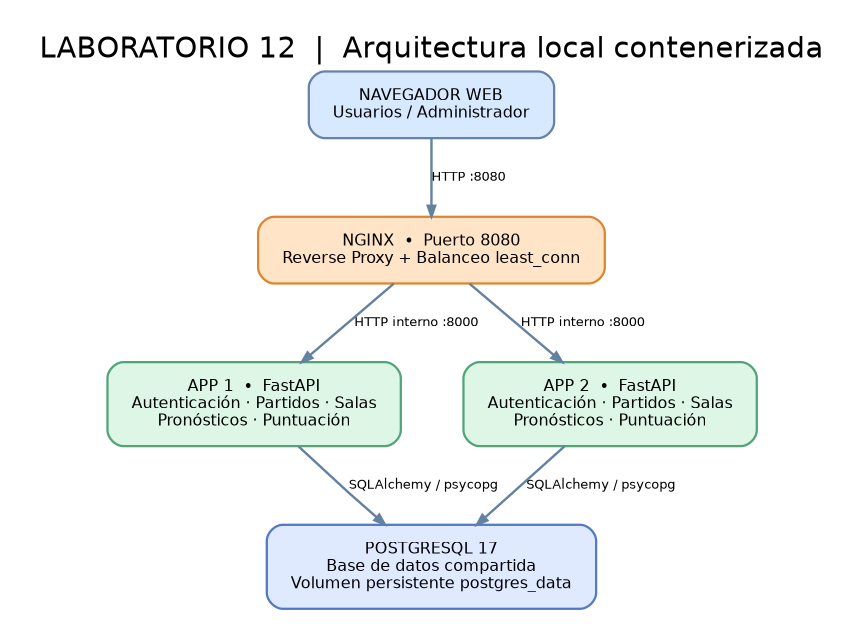
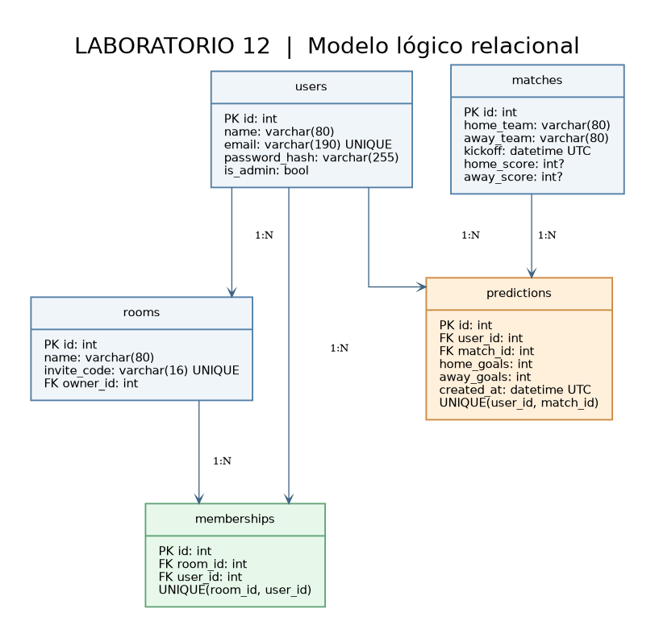
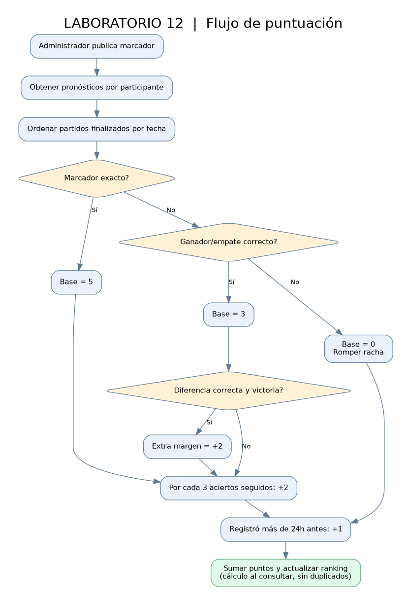

# Informe técnico — Laboratorio N.º 12

**Curso:** Desarrollo de Soluciones en la Nube  
**Tema:** Despliegue de Instancias Virtualizadas  
**Proyecto:** MundialLab12 — Sistema educativo de predicciones futbolísticas  
**Estudiante:** [Completar nombre]  
**Docente:** Jaime Farfán  
**Fecha:** [Completar fecha de entrega]

## 1. Resumen ejecutivo

Se implementó una aplicación web educativa para registrar pronósticos de partidos de fútbol, asignar puntos mediante cinco reglas y mostrar clasificaciones globales y por salas privadas. La aplicación se ejecuta sobre dos instancias FastAPI contenerizadas, distribuidas mediante Nginx y conectadas a una misma base de datos PostgreSQL. Se incluyen pruebas unitarias y de integración, mecanismo de detección de estado y un generador reproducible de carga. La solución se desarrolla localmente, modalidad autorizada por el docente.

## 2. Análisis de problemas y actores

**Problema:** sin un sistema único, los pronósticos y rankings pueden ser inconsistentes, las puntuaciones deben calcularse manualmente y los participantes carecen de espacios organizados para competir por grupos.

**Actores:** participante (registro, pronóstico, consulta de puntos), creador de sala (gestión de invitaciones e integrantes), administrador (gestión de partidos y resultados), servicio de base de datos (persistencia compartida).

**Requisitos funcionales:**

- RF-01: registro y autenticación con validación de credenciales.
- RF-02: listado de partidos y fechas UTC.
- RF-03: registrar o editar pronósticos exclusivamente antes del inicio.
- RF-04: publicar y corregir marcadores con autorización administrativa.
- RF-05: calcular automáticamente resultados exactos, ganador, diferencia, racha y anticipación.
- RF-06: mostrar clasificación global y puntaje por participante.
- RF-07: crear salas, generar códigos de invitación y permitir ingresar a otros usuarios.
- RF-08: mostrar ranking por sala; habilitar gestión de miembros, nombre y códigos al creador.
- RF-09: impedir registros duplicados y validar rangos de resultados.

**Requisitos no funcionales:** dos réplicas de aplicación, balanceo por Nginx, persistencia de PostgreSQL en volumen, aislamiento entre servicios, contraseñas con derivación PBKDF2, sesiones firmadas, CSRF para formularios, pruebas automáticas y mecanismo de stress testing.

## 3. Diseño y arquitectura



**Figura 1. Arquitectura de la solución.** El navegador accede al puerto 8080, Nginx reparte tráfico HTTP entre dos servicios FastAPI independientes y ambos leen/escriben PostgreSQL. Como las sesiones están firmadas con la misma clave y los datos residen en una BD compartida, el cambio de nodo no debe perder el inicio de sesión ni los pronósticos.



**Figura 2. Modelo de datos.** Usuarios, partidos y pronósticos (`UNIQUE(user_id,match_id)`), salas e integrantes (`UNIQUE(room_id,user_id)`). Los creadores de salas son usuarios registrados.



**Figura 3. Lógica de puntuación.** Los puntos se calculan a partir de marcadores oficiales cargados por administración y se reconstruyen cuando se corrige un resultado. Así se evita sumar accidentalmente puntos duplicados.

**Tecnologías seleccionadas:** Python/FastAPI (endpoints y validaciones), SQLAlchemy (persistencia relacional), PostgreSQL 17 (BD), HTML/Jinja y CSS (interfaz web), Docker Compose (orquestación local), Nginx (proxy inverso + algoritmo `least_conn`), script Python de biblioteca estándar para estrés.

## 4. Implementación y reglas

| Criterio | Fórmula o política |
|---|---|
| Resultado exacto | 5 puntos base, excluye los otros puntos base |
| Ganador / empate | 3 puntos cuando coincide 1X2 y no coincide el exacto |
| Diferencia de goles | 2 adicionales con mismo ganador y mismo margen no exacto (empates sin margen) |
| Racha | 2 puntos extra por cada tercer acierto 1X2 consecutivo de partidos finalizados; se interrumpe con fallo o sin pronóstico |
| Anticipación | 1 punto adicional si `kickoff - created_at > 24 h` |

**Nota interpretativa:** el documento de laboratorio no define si los 3 puntos por ganador y 2 por diferencia deben acumularse. Se optó por acumulación fuera del exacto y se declararon tests específicos. La predicción de último minuto (10 minutos antes) solo obtiene puntos base, no anticipación. El sistema rechaza pronósticos desde la hora de inicio.

**Flujo:** el administrador crea un partido; el usuario pronostica; el administrador publica marcador simulado; `compute_scoreboard` recorre los partidos finalizados cronológicamente, calcula el desglose y ordena el ranking; cada sala muestra el ranking filtrado por sus miembros. Las salas no modifican ni duplican el puntaje global.

**Validaciones y manejo de errores:** autenticación obligatoria; autorización de propietarios de salas y administrador; token CSRF en operaciones POST; correo único; contraseña de 8–128 caracteres; nombres de longitud controlada; goles 0–30; no se permite pronosticar después del inicio; se maneja colisión de correo e invitación/inscripción; mensajes amigables para acciones inválidas. Se incluyen respuestas 403/404 para accesos indebidos.

## 5. Despliegue

La ruta completa está en `README.md`. Comando principal en PowerShell dentro del directorio del proyecto:

```powershell
Copy-Item .env.example .env
notepad .env
docker compose up -d --build
docker compose ps
```

Abrir `http://localhost:8080`. Las credenciales iniciales se configuran en `.env`. El servicio `init` crea las tablas y el usuario administrador una sola vez; `db`, `app1`, `app2` y `nginx` sostienen la arquitectura de ejecución. El volumen `postgres_data` conserva la información si los contenedores se reinician.

## 6. Pruebas funcionales

| Caso | Resultado esperado | Evidencia |
|---|---|---|
| Registro | Crea un usuario único y conserva sesión | Captura [pendiente] |
| Pronóstico | Registra o edita antes del inicio | Captura [pendiente] |
| Resultado exacto | 5 puntos base | Unit test `test_exact_result_and_early_bonus` |
| Ganador correcto | 3 puntos base | Unit test `test_correct_winner_only` |
| Margen correcto | +2 puntos | Unit test `test_correct_margin_adds_two` |
| Racha 3 | +2 al tercer acierto consecutivo | Unit test `test_third_straight_correct_gets_two_points` |
| Anticipación | +1 solo cuando faltan más de 24 horas | Unit test `test_early_strictly_more_than_24_hours` |
| Registro + salas + resultado | Flujo de extremo a extremo | Test `test_full_journey` |
| Balanceo | Diferentes nodos en `/health` | Captura [pendiente de Docker] |
| Continuidad | App2 responde cuando App1 se detiene | Captura [pendiente de Docker] |

**Validación local del código:** el comando `python -m pytest -q tests` pasó **10/10** pruebas en el entorno de construcción del material. Esta ejecución usa SQLite en memoria, **no** sustituye la validación integral de Docker/PostgreSQL que debe hacerse en la PC.

## 7. Pruebas de estrés

**Herramienta:** `scripts/stress_test.py`, sin bibliotecas adicionales; HTTP concurrente con `ThreadPoolExecutor`.

| Escenario | Solicitudes | Solicitudes concurrentes (workers) | Éxitos | Latencia p95 | Rendimiento |
|---|---:|---:|---|---|---|
| Carga moderada | 300 | 20 | **Pendiente de ejecutar** | Pendiente | Pendiente |
| Carga mayor | 600 | 40 | **Pendiente de ejecutar** | Pendiente | Pendiente |

**Procedimiento:** levantar Docker, ejecutar los comandos del README, conservar `evidencias/stress_*.json`, registrar tasa de error y latencia p95, comparar ambos escenarios y adjuntar capturas del terminal. Se recomienda observar también `docker stats`. **No se consignan cifras falsas**: estas deben medirse en la PC antes de presentar.

## 8. Evidencias necesarias

1. `docker compose ps` mostrando las dos réplicas.
2. Página de inicio y predicciones con usuario autenticado.
3. Formulario admin para crear partidos y publicar resultados.
4. Pantalla de salas, invitación y tabla de puntajes.
5. Salidas de tests automáticos y los dos escenarios de estrés.
6. Reparto de peticiones y tolerancia al apagado de una réplica.

## 9. Conclusiones

**Primero**, se construyó una aplicación web educativa que concentra pronósticos y presenta clasificaciones actualizadas según criterios de puntuación claramente definidos.

**Asimismo**, la contenerización permitió ejecutar los componentes de manera reproducible, reduciendo dependencias instaladas directamente en Windows.

**Por otro lado**, el balanceador Nginx y las dos réplicas independientes representan una estrategia básica de escalamiento horizontal y redundancia.

**Además**, la separación del motor de puntuación facilitó crear pruebas unitarias para verificar los casos límite y reducir errores de negocio.

**Finalmente**, el entorno local cumple los requisitos técnicos propuestos y ofrece una base extensible para migración futura a AWS si resulta necesaria.

## 10. Limitaciones

La actividad es académica y local. No implementa procesamiento automático de resultados deportivos, correo real de invitaciones ni escalado automático. La validación real de infraestructura, las pruebas de estrés y las capturas deben realizarse desde la computadora del estudiante.

## Referencias documentales

- Guía de laboratorio 12 compartida por el docente: *Despliegue de Instancias Virtualizadas* (Tecsup, ciclo 2026-2).
- Docker Docs: https://docs.docker.com/desktop/setup/install/windows-install/
- Docker Compose: https://docs.docker.com/compose/
- Nginx HTTP Load Balancing: https://nginx.org/en/docs/http/load_balancing.html
- FastAPI: https://fastapi.tiangolo.com/
